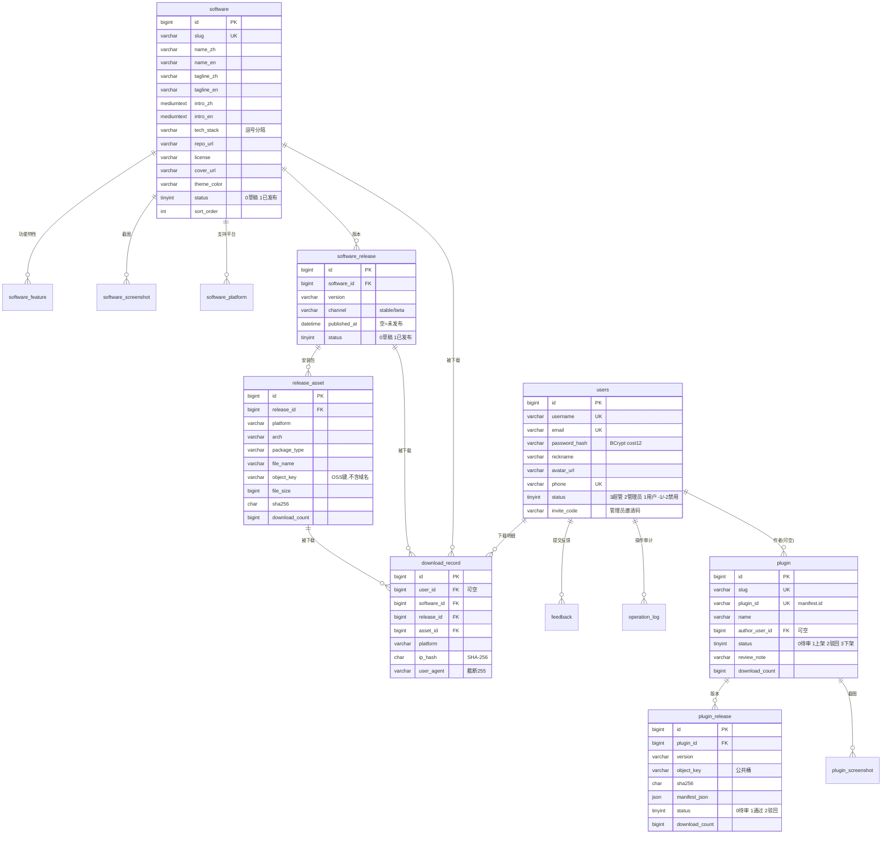

# 数据字典

> 文档编号：03 ｜ 版本：v1.0 ｜ 日期：2026-10-29 ｜ 状态：生效中
> 上游：[项目计划书](01-项目计划书.md) ｜ 兄弟：[术语与业务规则](02-术语与业务规则.md)、[接口文档](04-接口文档.md)

> [!IMPORTANT]
> **单一事实源：`db/01_schema.sql`。**
> 本文件是对它的**说明与汇总**，不是第二份定义。字段结构以 SQL 为准；两者冲突时，改 SQL 并同步本文件。
> 数据库：`hundun_lab`，字符集 `utf8mb4` / 排序规则 `utf8mb4_0900_ai_ci`，引擎 InnoDB，MySQL 8.0+。

---

## 1. 表清单

| 表 | 用途 | 状态 | 关键量级 |
| --- | --- | --- | --- |
| `users` | 账号（含角色） | 已建 | 百级 |
| `software` | 软件主表 | 已建 | 个位数 |
| `software_feature` | 功能特性 | 已建 | 十级/软件 |
| `software_screenshot` | 软件截图 | 已建 | 十级/软件 |
| `software_platform` | 平台支持 | 已建 | ≤3/软件 |
| `software_release` | 版本 | 已建 | 十级/软件 |
| `release_asset` | 安装包资产 | 已建 | ≤5/版本 |
| `download_record` | 下载明细 | 已建 | **增长最快** |
| `feedback` | 用户反馈 | 已建 | 百级 |
| `operation_log` | 后台操作审计 | 已建 | 千级 |
| `plugin` | 插件主表 | **计划**（M2，`db/10_plugin.sql`） | 百级 |
| `plugin_release` | 插件版本 | **计划**（M2） | 十级/插件 |
| `plugin_screenshot` | 插件截图 | **计划**（M2） | 十级/插件 |

---

## 2. ER 图

---

## 3. 字段说明

> 类型与默认值以 `db/01_schema.sql` 为准；"说明"列是对业务含义与坑点的补充。

### 3.1 `users` —— 账号

| 字段 | 类型 | 说明 |
| --- | --- | --- |
| `id` | `bigint` PK | 主键 |
| `username` | `varchar(50)` UK | 登录用；注册冲突统一报 `USER_ALREADY_EXISTS`（防枚举） |
| `email` | `varchar(100)` UK | 可空；用于验证码登录与通知 |
| `password_hash` | `varchar(255)` | BCrypt，cost 12；**永不出接口**（`/user/info` 返回实体时注意裁剪） |
| `nickname` | `varchar(50)` | 展示名；插件作者名优先取它 |
| `avatar_url` | `varchar(255)` | 头像 URL（公共桶） |
| `phone` | `varchar(20)` UK | 可空 |
| `status` | `tinyint` | `3` 超管 / `2` 管理员 / `1` 普通 / `-1` 用户禁用 / `-2` 管理员禁用。**负数不是"已删除"** |
| `invite_code` | `varchar(32)` | 管理员邀请码；普通用户为 NULL |
| `created_at` / `updated_at` / `last_login_at` | `datetime` | |

索引：`PRIMARY(id)`、`UNIQUE(username)`、`UNIQUE(email)`、`UNIQUE(phone)`

### 3.2 `software` —— 软件

| 字段 | 类型 | 说明 |
| --- | --- | --- |
| `id` | `bigint` PK | |
| `slug` | `varchar(64)` UK | URL 标识，如 `hundundesktop`；**对外 URL 的唯一依据**，不要改 |
| `name_zh` / `name_en` | `varchar(64)` | 双语名称，均非空 |
| `tagline_zh` / `tagline_en` | `varchar(160)` | 一句话简介 |
| `intro_zh` / `intro_en` | `mediumtext` | 详细介绍，支持 Markdown |
| `tech_stack` | `varchar(255)` | 逗号分隔；接口层已拆成 `List<String>` 返回 |
| `repo_url` | `varchar(255)` | 源码仓库 |
| `license` | `varchar(64)` | 软件自身的许可（HundunDesktop 为 MIT） |
| `cover_url` | `varchar(500)` | 封面图（公共桶） |
| `theme_color` | `varchar(16)` | 卡片主色，如 `#C3272B`；与站点主题变量是两回事 |
| `status` | `tinyint` | `0` 草稿 / `1` 已发布；**草稿对前台不可见** |
| `sort_order` | `int` | 升序展示 |

索引：`UNIQUE(slug)`、`KEY(status, sort_order)`

### 3.3 `software_feature` —— 功能特性

| 字段 | 说明 |
| --- | --- |
| `software_id` FK | 级联删除（`ON DELETE CASCADE`） |
| `icon` | emoji 或图标名 |
| `title_zh` / `title_en` | 非空 |
| `desc_zh` / `desc_en` | ≤500 |
| `sort_order` | 升序 |

索引：`KEY(software_id, sort_order)`

### 3.4 `software_screenshot` —— 软件截图

`software_id` FK（CASCADE）、`image_url`（非空，公共桶 URL）、`caption_zh` / `caption_en`、`sort_order`。
索引：`KEY(software_id, sort_order)`

### 3.5 `software_platform` —— 平台支持

`software_id` FK（CASCADE）、`platform`（`win32`/`darwin`/`linux`）、`note_zh` / `note_en`、`sort_order`。
**唯一约束 `UNIQUE(software_id, platform)`** —— 同一平台只能有一条。
注意：平台支持与"实际有安装包"是两件事，平台可先声明（"即将支持"）。

### 3.6 `software_release` —— 版本

| 字段 | 说明 |
| --- | --- |
| `software_id` FK | CASCADE |
| `version` | 语义化版本或产品版本号（HundunDesktop 用 `26.2.1024` 式日期版本） |
| `channel` | `stable` / `beta`，默认 `stable` |
| `notes_zh` / `notes_en` | 更新说明，支持 Markdown |
| `published_at` | **为空表示尚未发布**；"最新版"按此字段倒序推导 |
| `status` | `0` 草稿 / `1` 已发布 |

唯一约束：`UNIQUE(software_id, version, channel)`；索引：`KEY(software_id, status, published_at)`

### 3.7 `release_asset` —— 安装包资产

| 字段 | 说明 |
| --- | --- |
| `release_id` FK | CASCADE |
| `platform` / `arch` / `package_type` | 见 §5 枚举字典 |
| `file_name` | 用户下载时看到的文件名 |
| `object_key` | OSS 对象键，**不含域名**；桶为私有 |
| `file_size` | 字节 |
| `sha256` | 前端展示前 12 位供用户比对 |
| `download_count` | 与 `download_record` 在同一事务内自增 |

唯一约束：`UNIQUE(release_id, platform, arch, package_type)`（同一版本同一变体只能一个包）

### 3.8 `download_record` —— 下载明细

| 字段 | 说明 |
| --- | --- |
| `user_id` FK | `ON DELETE SET NULL`（用户注销后保留统计） |
| `software_id` / `release_id` / `asset_id` | 冗余存储以便多维统计 |
| `platform` | 冗余 |
| `ip_hash` | **SHA-256 摘要，不落明文 IP** |
| `user_agent` | 截断到 255 字符 |

索引：`KEY(user_id, created_at)`、`KEY(software_id, created_at)`、`KEY(asset_id, created_at)`

### 3.9 `feedback` —— 反馈

沿用底座结构，仅追加列（`software_id`、`contact`、`lang`），**不改既有字段语义**。
`status`：`0` 未处理 / `1` 已处理 / `-1` 驳回；`lang` 记录提交时语言，便于用原语言回复。

### 3.10 `operation_log` —— 后台操作审计

只写后台关键操作（审核、上下架、删除、发版），**不给下载/浏览这类高频动作写审计**（下载已有 `download_record`）。
`executed_sql` 字段存在但是 `text`，**不要把含用户隐私的 SQL 原样落库**。

### 3.11 计划表（M2）

完整 DDL 见[项目计划书 §11.2](01-项目计划书.md)；落库时以 `db/10_plugin.sql` 为准。要点复述：

| 表 | 关键字段与设计意图 |
| --- | --- |
| `plugin` | `slug` + `plugin_id` 双唯一（`slug` 默认取 `manifest.id`）；`status` 四态；`review_note` 必须展示给作者 |
| `plugin_release` | `UNIQUE(plugin_id, version)`；`manifest_json`/`permissions`/`platforms` 用 `json` 列；`status` 三态，**更新版本即新增一条并重新审核** |
| `plugin_screenshot` | 仅 `image_url` + `sort_order`（无双语说明，插件截图一般不需要文案） |

---

## 4. 外键与级联规则

| 子表.字段 | → 父表 | 删除行为 | 理由 |
| --- | --- | --- | --- |
| `software_feature.software_id` | `software.id` | `CASCADE` | 内容块随软件消失 |
| `software_screenshot.software_id` | `software.id` | `CASCADE` | 同上 |
| `software_platform.software_id` | `software.id` | `CASCADE` | 同上 |
| `software_release.software_id` | `software.id` | `CASCADE` | 同上 |
| `release_asset.release_id` | `software_release.id` | `CASCADE` | 版本删了包就没意义（**OSS 对象需另行删除**） |
| `download_record.user_id` | `users.id` | `SET NULL` | 保住下载统计 |
| `feedback.user_id` | `users.id` | 无（RESTRICT） | 反馈不该随用户消失而静默消失 |
| `plugin.author_user_id` | `users.id` | `SET NULL` | 作者注销后插件保留 |
| `plugin_release.plugin_id` | `plugin.id` | `CASCADE` | |
| `plugin_screenshot.plugin_id` | `plugin.id` | `CASCADE` | |

> **注意**：ORM 级联只管数据库行，**OSS 上的对象必须业务代码显式删除**，否则留下既不可达又持续计费的孤儿文件。

---

## 5. 枚举字典

> 这是全项目最容易出错的地方：同一个 `status` 在不同表里含义完全不同。

| 枚举 | 取值 | 含义 | 出现位置 |
| --- | --- | --- | --- |
| **账号状态** `users.status` | `3` | 超级管理员 | 可生成邀请码、管理管理员 |
| | `2` | 管理员 | 后台业务操作 |
| | `1` | 普通用户 | 默认注册值 |
| | `-1` | 用户禁用 | 请求即被拦截，立即吊销令牌 |
| | `-2` | 管理员禁用 | 同上 |
| **软件发布态** `software.status` | `0` | 草稿（前台不可见） | |
| | `1` | 已发布 | |
| **版本发布态** `software_release.status` | `0` | 草稿 | `published_at` 通常为空 |
| | `1` | 已发布 | |
| **版本通道** `channel` | `stable` | 稳定版（默认） | |
| | `beta` | 测试版 | |
| **平台** `platform` | `win32` | Windows | |
| | `darwin` | macOS | |
| | `linux` | Linux | |
| **架构** `arch` | `x64` | 64 位 x86（默认） | |
| | `arm64` | ARM 64 | |
| **包格式** `package_type` | `nsis` | Windows 安装包（HundunDesktop 现用） | |
| | `appimage` | Linux AppImage | |
| | `deb` | Debian 包 | |
| | `dmg` | macOS 镜像 | |
| | `zip` | 压缩包 | |
| **反馈状态** `feedback.status` | `0` | 未处理 | |
| | `1` | 已处理 | |
| | `-1` | 驳回 | |
| **操作结果** `operation_log.operate_status` | `1` | 成功 | |
| | `0` | 失败 | |
| **插件状态** `plugin.status`（M2） | `0` | 待审（前台不可见） | |
| | `1` | 已上架（公开可见、可下载） | |
| | `2` | 已驳回（作者可改后重提） | |
| | `3` | 已下架（前台 404、短链失效） | |
| **插件版本状态** `plugin_release.status`（M2） | `0` | 待审 | |
| | `1` | 通过（成为可下载的最新版） | |
| | `2` | 驳回 | |
| **插件权限** `permissions` | `storage` | 本地存储 | 站点只作展示与白名单校验 |
| | `messaging` | 消息通信 | |
| | `notifications` | 通知 | |
| | `clipboard` | 剪贴板 | |
| **站点主题** `data-theme` | `hun-tun-yellow` | 馄饨黄（默认） | 前端 `tokens.css`，不落库 |
| | `hun-tun-dark` | 馄饨黑 | |
| **语言** `lang` | `zh` / `en` | 界面与内容语言 | `feedback.lang`、i18n |

---

## 6. 索引清单

| 表 | 索引 | 类型 | 服务场景 |
| --- | --- | --- | --- |
| `users` | `unique_username` / `unique_email` / `unique_phone` | UNIQUE | 登录查重 |
| `software` | `uk_software_slug` | UNIQUE | 详情页路由 |
| `software` | `idx_software_status_sort` | KEY | 列表页（已发布 + 排序） |
| `software_feature` | `idx_feature_software` | KEY | 详情聚合 |
| `software_screenshot` | `idx_screenshot_software` | KEY | 详情聚合 |
| `software_platform` | `uk_platform_software` | UNIQUE+KEY | 防重复声明 |
| `software_release` | `uk_release_version` | UNIQUE | `(software_id, version, channel)` |
| `software_release` | `idx_release_published` | KEY | **推导最新版本** |
| `release_asset` | `uk_asset_variant` | UNIQUE | 同变体唯一 |
| `release_asset` | `idx_asset_release` | KEY | 版本→资产 |
| `download_record` | `idx_download_user` / `idx_download_software` / `idx_download_asset` | KEY | 我的下载 / 统计 |
| `feedback` | `idx_feedback_status_created` | KEY | 后台待办 |
| `operation_log` | `idx_operate_user_id` / `idx_operate_at` / `idx_module_name` | KEY | 审计查询 |
| `plugin`（计划） | `uk_plugin_slug` / `uk_plugin_pid` / `idx_plugin_status_time` / `idx_plugin_author` | | 路由 / 审核台 / 我的插件 |
| `plugin_release`（计划） | `uk_plugin_version` / `idx_plugin_release_status` | | 版本唯一 / 找最新版 |

---

## 7. 数据同步、增量与备份规则

| 规则 | 内容 |
| --- | --- |
| **脚本顺序** | `01_schema.sql`（DDL）→ `02_seed.sql`（首批内容）→ `1x_*.sql`（增量） |
| **幂等** | 所有脚本可重复执行：`CREATE TABLE IF NOT EXISTS`、种子用 `ON DUPLICATE KEY UPDATE` |
| **只增不改** | 不修改 `01_schema.sql` 的既有列语义；结构变更一律写增量脚本（如 `db/10_plugin.sql`） |
| **无用户数据** | 仓库内不出现任何用户行（底座 `file/hundun.sql` 曾含真实 bcrypt 哈希与手机号，已在改造中清除——**不要回退**） |
| **不放二进制** | 安装包、截图、头像一律进 OSS，仓库只存 URL / `object_key` |
| **备份** | MySQL 定期 `mysqldump`（含结构与数据）；OSS 开启版本控制或异地备份；备份恢复演练见 `docs/06-部署手册.md`（M1 产出） |
| **环境** | 本地 `dev` 与生产共用同一套脚本；生产不执行 `02_seed.sql` 的示例内容（种子幂等，但示例文本不应出现在生产） |

---

## 8. 分库分表 / 分区策略

**N/A —— 本项目不做。**

理由（写下来以免日后有人提议）：`download_record` 是唯一可能增长的表，但按当前量级（个人项目、单个安装包、日下载量三位数以内）
单表可支撑多年；分区或分表会立刻带来"统计要跨片聚合"的成本，收益为负。
**触发重新评估的条件**（任一成立再议）：单表超过 2000 万行、或单表超过 10GB、或出现明显的写入热点。
在此之前，正确的优化顺序是：索引 → 归档冷数据（按年导出后删除）→ 才考虑分区。
